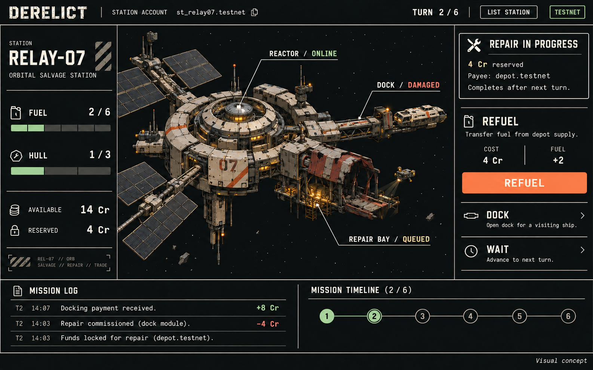
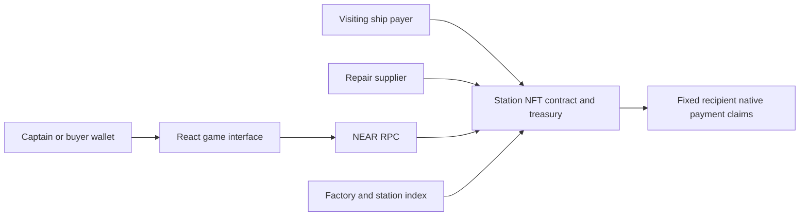

# DERELICT Product Design and Execution Plan

DERELICT is a six-turn orbital salvage strategy game. Each station is an NFT and a real NEAR account that holds funds, equipment state, prepaid docking offers, and repair obligations. The captain manages fuel, damage, income, and upgrades, and can sell the operating station while work remains unfinished.

The product hook is **Buy the station and inherit its condition and commitments.** A sale changes who can command the station. It preserves its resources, history, money, and creditor rights.

The hackathon build should make one complete game exceptional: a readable station scene, meaningful decisions, actual testnet accounting, a secure mid-repair sale, and a reproducible judging walkthrough. Primary track: NFTs That Do Something. Secondary track: Games With Real Economies.

This is the implementation specification. The economic values are initial tuning parameters. The schedule assumes contract and frontend work can proceed in parallel, beginning November 7 and finishing before November 14, 2026 at 23:59 UTC. [Official hackathon guidance](https://nearhackathon.com/HACKATHON.md)

# Product scope

The release contains one station design, a six-turn campaign, standard and heavy docking jobs, a fuel supplier, one repair type, one dock upgrade, a direct station sale, and a transaction history. Three fixed starting scenarios reuse the same contracts and interface: standard salvage, fuel shortage, and a cash-poor damaged station. Complete and validate standard salvage first; add the other scenarios only after its full loop passes.

The station has three visible modules: reactor, dock, and repair bay. Fuel and hull are integer resources. Funds use native testnet NEAR. Equipment is recorded as station inventory and module state; issuing a separate NFT for every component is unnecessary for this release.

The core participants are the current captain, a potential buyer, a visiting ship payer, and the repair supplier. A person may use multiple test accounts during the recorded demonstration, but the interface and README must identify demo traffic accurately.

A successful build demonstrates that the station can receive a docking payment, spend earned funds, reserve a repair fee, change captains, reject the former captain’s management instructions, and preserve the original supplier’s claim.

The release boundary excludes combat, an open-world map, a custom fungible token, cross-chain settlement, and AI-controlled economic decisions. These features would compete with the time needed for the game, transfers, and presentation.

# Game rules

## Campaign objective

A campaign lasts six gameplay turns. Finish with at least one hull point and at least three completed docking jobs. Among successful runs, the score is the station’s final operating treasury. Keep hull, fuel, and served-job count visible beside the score so players can compare condition as well as cash.

A gameplay action consumes one turn. Selling, buying, observing the station, claiming an existing payment, and receiving a callback do not consume turns. A failed action changes neither the game state nor the turn.

Starting state for standard salvage: 10 credits of operating funds, 4 fuel, 2 hull, no upgrade, no repair, zero served ships. Fuel capacity is 6. Hull capacity is 3.

**One displayed credit is exactly 0.001 testnet NEAR.** Credits are a display unit, not a token or a second currency. Store amounts as integer yoctoNEAR and quantities as integers. Initial operating funds therefore equal 0.010 testnet NEAR. Storage and execution reserves are funded separately and excluded from the score.

## Actions

| Action | Cost | Result | Conditions |
| --- | --- | --- | --- |
| Standard docking | 1 fuel | Earn 3 credits and serve one ship; earn 5 credits after dock upgrade | Hull at least 1; an eligible prepaid standard offer |
| Heavy docking | 2 fuel and 1 hull | Earn 8 credits and serve one ship | Hull at least 1; an eligible prepaid heavy offer |
| Refuel | 2 credits per unit; buy 1 to 4 units | Add the purchased fuel | Operating funds sufficient; fuel never exceeds 6 |
| Commission repair | Reserve 4 operating credits | Restore 2 hull after the next gameplay action, capped at 3 | One active repair at most; hull below 3; cannot purchase on turn 6 |
| Upgrade dock | 4 operating credits | Future standard docking fees become 5 credits | One upgrade per campaign |
| Wait | No fee | Advance the campaign and allow an existing repair effect to arrive | Campaign has an unplayed turn |

Heavy docking may reduce hull from 1 to 0. At zero hull, docking is disabled, but refueling, repairs, upgrading, and waiting remain possible. Game damage never deletes the NEAR account or removes financial claims.

For every valid action, apply that action’s effects and advance the turn, then apply any previously commissioned repair that is due. A repair bought on turn 3 has its effect after the turn-4 action. A newly commissioned repair cannot also complete during its own action. On turn 6, process a due repair before evaluating the mission outcome.

Repair purchases cannot overlap. Their effect is applied once. An action rejected for insufficient fuel, cash, hull, or an expired offer does not advance a repair.

## Two reproducible strategies

| Turn | Investment route | Funds / fuel / hull | Repair route | Funds / fuel / hull |
| --- | --- | --- | --- | --- |
| Start | Initial state | 10 / 4 / 2 | Initial state | 10 / 4 / 2 |
| 1 | Upgrade | 6 / 4 / 2 | Standard docking | 13 / 3 / 2 |
| 2 | Standard docking | 11 / 3 / 2 | Heavy docking | 21 / 1 / 1 |
| 3 | Standard docking | 16 / 2 / 2 | Commission repair | 17 / 1 / 1 |
| 4 | Standard docking | 21 / 1 / 2 | Buy 3 fuel; repair takes effect | 11 / 4 / 3 |
| 5 | Standard docking | 26 / 0 / 2 | Heavy docking | 19 / 2 / 2 |
| 6 | Wait | 26 / 0 / 2 | Heavy docking | 27 / 0 / 1 |

Both routes serve four ships. The repair route is the main judging scenario: insert the sale between turns 3 and 4. Ownership transfer changes none of the figures in that table.

The strategy model was enumerated during planning. Under these starting rules and sufficient valid offers, its maximum final operating treasury is 27 credits. That result describes the bounded model; it does not establish long-term economic balance or that the finished game is fun. Re-run the enumeration against the implemented transition rules before claiming parity.

Use additional starting scenarios to create different decisions. Each scenario must have at least one verified winning path and one genuine losing path. Freeze its constants and funding requirements in a fixture shared by the application and tests.

# Docking payments and repair obligations

## Source of docking income

Every docking offer is funded by a visiting-ship account before the captain accepts it. The station holds that payment in visitor escrow. Accepting a valid offer releases the applicable fee into operating funds in the same receipt that consumes fuel, changes hull, and marks the offer used. The contract does not create money when a ship docks.

A standard offer authorizes a maximum fee of 5 credits: charge 3 without the upgrade or 5 with it. The unused 2 credits remain the original visitor’s refundable balance. A heavy offer escrows 8 credits.

For the judging fixture, seed six standard offers and six heavy offers: a total of 78 credits, or 0.078 testnet NEAR, from the demo visitor account. This deliberately covers alternative action choices across all six turns. These funds are separate from the captain’s 10-credit opening treasury.

Each offer records its payer, unique ID, allowed type, campaign ID, authorized fee rule, and an expiry based on NEAR block height. Only one offer can be consumed per docking action. The payer can reclaim unaccepted expired offers independently of the captain. When a campaign closes, unused offers become refundable. Acceptance and refund must not both succeed.

The interface offers Standard and Heavy choices with the best eligible funded offer already selected. Detailed offers and refunds belong in the ledger, keeping the main game readable.

## Repair effect and supplier payment

Commissioning a repair moves 4 credits from operating funds into a protected repair obligation. Record its supplier account, amount, campaign ID, effect-due turn, payment-eligibility block, and separate effect and payment statuses. These values survive every transfer.

The repair is a deterministic in-game service. Its hull improvement is guaranteed by the game rules after the next valid action; no claim of verifying physical labor or an external contractor is involved.

Payment eligibility uses a fixed block-height threshold recorded at purchase. Once that threshold is reached, the supplier can claim independently of whether the captain advances another turn. Claiming the fee does not advance gameplay or apply the hull effect. Conversely, applying the hull effect does not pay twice or cancel the supplier’s claim.

This separates game timing from a creditor’s ability to collect. In the demonstration, transfer the station while the repair is active, apply its effect with the next gameplay action, then show the original supplier receiving its fee. If the block threshold has not yet been reached, show the actual status and settle when eligible. Never replace it with a fake countdown.

# Ownership and accounting

## The station account

Each station is an independent NFT contract containing one station NFT, its game state, and its treasury. For example, the identity is the pair of station account and local token ID; the factory is only a discovery index.

Use one ownership value: the owner returned by the NFT implementation. The game reads that same value to authorize captain actions. A separate captain field must not become another ownership authority.

Every ownership change increments an ownership epoch, including a transfer rollback. Every economically relevant mutation increments a state revision. Prepared actions and sale quotes bind to the correct campaign, revision, and epoch.

## Treasury buckets

| Bucket | Entitlement | Can the captain spend it during gameplay |
| --- | --- | --- |
| Operating funds | Station’s earned and opening game budget | Through permitted game actions |
| Visitor escrow and refunds | Original visiting-ship payer | No |
| Repair reserve and supplier receivable | Supplier fixed when ordered | No |
| Station sale proceeds | Seller fixed by the purchase | No |
| Pending disbursements | Recipient fixed before the outgoing promise | No |
| Storage and execution reserve | Contract operation | No |

The visible NEAR account balance is not the available game budget. Show operating funds and protected amounts separately. Do not add sale payments, visitor deposits, direct donations, storage funding, or gas top-ups to the score.

For the initial release, operating withdrawals are available after the campaign finishes; mid-campaign top-ups and withdrawals are disabled. Existing visitor refunds, supplier payments, and seller proceeds remain claimable according to their own terms.

A former captain may still collect legitimate sale proceeds or an earlier creditor claim. Losing captain authority does not erase a debt owed to that account.

## Station sale

The seller sets a price. The inspection overlay shows the station’s current resources, upgrade, operating funds, reserved repair, supplier, pending claims, turn, and history. Display an explicit note that the purchase price is paid to the seller and does not fund station operations.

The buyer submits the exact price and expected owner, campaign, and state revision. The buy method checks those values, changes NFT ownership, increments the epoch, and creates the seller’s fixed receivable in one station-contract receipt. An intervening economic change invalidates the quote; the buyer reviews refreshed state before retrying.

Sales and direct transfers consume no turn. They preserve every resource, offer, repair, and financial claim. Transfer to the station’s own account is rejected.

## Outgoing payments

Use a recorded lifecycle: claimable, pending, then paid; a failed native transfer returns the amount to exactly one claimable record. Record operation ID, recipient, amount, and liability category before issuing the promise. A callback never chooses its payee by looking up the current NFT owner.

The station’s operating budget never receives a temporary credit while a payment is pending. Duplicate requests and repeated callback handling cannot pay again. A callback failure remains visible and protected; do not blindly refund or unlock based only on a timeout.

# Interface and visual design



The image is an art-direction concept, not a screenshot of completed software. The rules and exact state examples below are the implementation reference. [Image generation record](design/image-generation.json)

## Art direction

DERELICT should feel like an orbital salvage console: dark graphite, worn ceramic metal, warm readable type, industrial markings, and a single orange action accent. The station illustration is the focal point. Interface panels frame it without competing for attention.

Use a detailed 2D station illustration, layered module overlays, and small ships or drones. The game does not require a 3D engine. Keep resource labels, controls, damage indicators, and account information as live UI rather than baking them into artwork.

| Element | Specification |
| --- | --- |
| Background | Graphite #101416 |
| Raised surface | #191F21 |
| Main text | Warm white #E9E5DC |
| Secondary text | #ABB2AD, checked for readable contrast |
| Primary action | Signal orange #EE7948 |
| Healthy state | Pale green #A7C0AA with an icon and label |
| Damage | Oxide red #C86B59 with an icon and label |
| Borders | Quiet gray #394246 |
| Display type | Barlow Condensed, semibold or bold |
| Controls and prose | IBM Plex Sans |
| Accounts and numbers | IBM Plex Mono with tabular figures |

Use an 8-pixel spacing system with 16-, 24-, and 32-pixel main gaps. Body text is 15–16 pixels at the target laptop size. Controls have at least a 44-pixel interactive target. Use icons and text as well as color. Keyboard focus must remain visible.

## Main station screen

At a 1440 by 900 reference size, use a roughly 64-pixel header, a 220-pixel left status rail, a flexible station canvas, a 300-pixel right decision rail, and a 140-pixel bottom activity area. Adapt those dimensions so the entire primary interaction is visible at 1366 by 768.

The header contains DERELICT, the station identifier, turn progress, connection status, and List Station. The left rail contains fuel, hull, available operating funds, protected repair funds, and current captain. The canvas shows the reactor, dock, and repair bay with inspectable labels. The right rail contains the selected action’s cost, resource preview, and confirmation. The bottom contains recent events and the six-turn history.

Future turns show empty numbered positions; do not pre-label future actions as if the campaign were scripted.

Selecting an action previews its consequences before signing. For example: Refuel 3 units, cost 6 credits, fuel 1 to 4, next turn repair restores hull 1 to 3. This preview must use the same rules as contract tests and be labeled as a preview until confirmed.

## Four interface surfaces

| Surface | Main purpose | Required behavior |
| --- | --- | --- |
| Station bridge | Play the campaign | Resource preview, action confirmation, confirmed-state rendering |
| Inspect and buy overlay | Understand what ownership includes | Price, available funds, protected obligations, revision refresh |
| Ledger drawer | Inspect money and authority | Filterable events, fixed recipients, pending and failed payment states, transaction links |
| Mission result | Compare and replay | Success or failure reason, operating score, action history, fresh-run option |

A station browser can be a lightweight entry view over the factory index. It reuses the inspection layout; a separate marketplace application is unnecessary.

## Motion and sound

Use short ship arrival and docking animations, a restrained drone motion while repair is active, a visible hull-module restoration, and a captain badge change on transfer. Important actions receive a concise ledger entry. Reserve 120–220 milliseconds for interface transitions; longer decorative movement must never delay the next interaction.

The application may show a submitted transaction as pending. Fuel, hull, income, and ownership update only after the selected confirmed-chain state is read. Browser refresh reconstructs the game from contract state. Reduced-motion mode preserves every interaction and status.

Sound is optional, muted by default, and added after the complete game passes. On narrow screens, stack the station and controls and collapse the ledger into a drawer. Desktop and small-laptop polish take priority.

# Technical implementation

## Components

Use Rust with the current compatible NEAR SDK and contract-standards library for contracts, TypeScript for shared game fixtures and client code, and React with Vite for the application. Use SVG and CSS overlays for the station; introduce a canvas library only if the prototype proves it materially simplifies rendering. Pin exact compatible versions when implementation begins and record them in the lockfiles and README.

A wallet integration signs live actions. Browser reads use NEAR RPC. A small query/cache layer reconciles confirmed state and event history. Persistence is on-chain; an application database or authoritative game server is unnecessary.



## Contract responsibilities

The factory creates and funds a station account, deploys its fixed code, initializes the single NFT and campaign, and indexes its account ID. Create the child without access keys. The factory retains no station spending authority. Expose enough account and code information for judges to verify that control resides in the contract. Use ordinary deployment for this small fleet rather than adding a new global-contract dependency.

The station owns all authoritative economic and game state. Its principal methods cover state and NFT views, captain actions, funding and accepting docking offers, repair obligations, listings and purchases, direct transfers, and fixed-recipient claims. Methods accepting game actions bind to a campaign ID and expected revision. Callback methods are private and check their operation IDs.

Deploy fixed station code for the judging release. Omit generic execution, key creation, arbitrary code replacement, and account deletion. A game-over state must still permit settlement of legitimate claims.

## NFT receiver transfers

Implement the supported NEP-171 core behavior with NEP-177 metadata using the maintained contract-standards implementation as the starting point. Approval management and third-party marketplace integrations are outside the initial scope.

The receiver callback path requires additional protection because the receiver can provisionally own an NFT before accepting or returning it. Lock game mutations, captain spending, sales, and new economic commitments throughout this interval. Advance the ownership epoch on a change and on a rollback. Keep unrelated fixed creditor claims safe and independent.

Choose and document transfer restrictions deliberately, including whether forwarding the NFT before receiver resolution is supported. Verify the chosen semantics against the actual library and standard. Do not claim universal marketplace compatibility.

If a receiver-resolution callback stalls, expose the pending state and keep the station protected. A timeout alone cannot prove acceptance or rejection. Resolve this behavior and test its failure modes before the standards-compliance milestone; a red test is a release blocker, not a reason to hide the path.

## Repository structure

```text
contracts/station/        Station NFT, game, treasury, offers and sale
contracts/factory/        Station deployment and discovery
apps/web/                Game interface and wallet integration
packages/game-model/     Pure transition model, fixtures and previews
tests/integration/       Sandbox, receiver and payout-failure scenarios
scripts/                 Build, deploy, seed, inspect and fresh-demo commands
docs/                    Architecture, threat model, rules and judging guide
```

The TypeScript model supports practice mode and previews. Rust is authoritative for live gameplay. Run the same action fixtures against both implementations and compare outputs so the client cannot silently drift from the contracts.

# Play and replay modes

Practice mode runs the shared deterministic model locally and is clearly marked Practice. It allows a judge to learn the six-turn loop immediately.

Live testnet mode uses actual NEAR accounts, wallet signatures, funded visitor offers, and native payments. It is clearly marked Testnet. An RPC or wallet failure stays visible; the application never silently substitutes a simulated balance or success.

Replay mode reads a completed run’s action and financial history. It can animate recorded events but must distinguish replay from a new transaction.

The fresh-run command creates a new station account and seeds documented starting resources and demo traffic. Resetting the interface must not rewrite an existing on-chain history. For the hosted demo, maintain multiple fresh runs in advance and expose their real status.

Avoid requiring a judge to operate four wallets to understand the game. Let visitors start in practice or spectator mode. The recorded live demonstration can show separate captain, buyer, visitor, and supplier accounts. Setup instructions explain how to reproduce those roles using fresh local sandbox accounts and testnet accounts.

# Execution schedule

The plan assumes one person owns contracts and verification while another owns interface and visual assets. A third person, if available, owns integration, fixtures, deployment scripts, and the demo. With two people, the contract owner takes integration and the frontend owner takes presentation. With one person, prioritize the standard scenario and the sale sequence before extra scenarios and optional polish.

| Date | Work | Completion gate |
| --- | --- | --- |
| November 7 | Freeze rules and shared fixtures; implement station NFT ownership, resource transitions and ledger buckets; build the bridge layout | Both verified strategies run in the model; contract can initialize and take a real action |
| November 8 | Implement prepaid docking offers, fuel, upgrade, repair effect and supplier claim; connect the first action flow to sandbox | One funded campaign can reach a success and a failure; financial buckets reconcile |
| November 9 | Implement listing, revision checks, purchase, ownership epochs and payout lifecycle; finish receiver-transfer protections | Mid-repair purchase works; old captain action rejects; claims retain recipients; receiver attack tests pass |
| November 10 | Deploy factory and stations to testnet; complete wallet integration, inspection overlay, ledger and fresh-run script | Complete standard campaign, sale, supplier payment and reload work end to end |
| November 11 | Finish station artwork and module states; add motion, action previews, onboarding, result screen and two verified scenarios | Small-laptop interface is readable; a new tester can complete a run without explanation |
| November 12 | Run adversarial integration checks and contract/client parity; test fresh setup, payout failures, RPC failures and browser reloads | No unresolved ownership, accounting, receiver-transfer or payout failures |
| November 13 | Freeze features; rehearse the judge walkthrough, record video, prepare README and public submission material | A clean checkout reproduces the documented result; demo and repository links are ready |
| November 14 | Final hosted smoke test, submission and contingency buffer | Submit before an internal 20:00 UTC target; official cutoff is 23:59 UTC |

**Critical milestone:** by November 10, the complete live flow must work. After that date, add presentation quality and fix defects. Features that would move that milestone are deferred.

If time compresses, reduce the scenario count, remove optional sound and cosmetic animation, and simplify the station browser. Keep the real game loop, mid-repair sale, protected funds, payment failure handling, and honest status displays intact.

Track failures in a short issue list ordered by whether they block the game, corrupt financial state, obscure evidence, or affect presentation. Fix in that order.

# Verification and release gates

| Area | Evidence required |
| --- | --- |
| Game rules | The two published strategies produce the documented states; a losing path fails for the correct reason |
| Client parity | Shared fixtures match the Rust transitions and TypeScript preview model |
| Funded income | Every earned docking fee is backed by a previously funded offer |
| Visitor funds | Unused authorization remains payable to the original payer; acceptance and refund cannot double-spend |
| Repair continuity | Transfer preserves amount, supplier, effect timing and payment eligibility |
| Supplier collection | A supplier can collect after its block threshold even if gameplay stops |
| Sale accounting | Exact-price purchase moves ownership and records seller proceeds without increasing game funds |
| Quote freshness | Any relevant change causes a stale purchase or action revision to reject |
| Authority | Former captain’s identical management instruction fails; the current captain’s valid instruction succeeds |
| Receiver rejection | A provisional receiver cannot drain funds or mutate the game before returning the NFT |
| Payout lifecycle | Success, failure, retry and duplicate callbacks preserve exactly one entitlement |
| Contract authority | No station access keys or factory spending backdoor; game-over accounts can settle claims |
| Interface truth | Pending is distinct from confirmed; errors never display success; reload restores live state |
| Reproduction | Fresh checkout, dependency installation, contract build and scenario setup follow the README |
| Presentation | Main interaction fits 1366 by 768; controls are keyboard reachable; reduced motion works |

Use unit tests for deterministic rules and sandbox integration tests for real receipts, native-transfer failures, receiver rejection and ownership changes. Use a small browser flow for the complete campaign and sale. Use actual testnet transactions for the recorded integration evidence.

Tests should check observable invariants and outcomes rather than repeat private implementation details. A clean test run is necessary but does not replace playing the full interface.

The financial review must include in-flight obligations and runtime reserves. Never infer solvency merely by adding the visible widget numbers while transfers are unresolved.

# Judging demonstration

Use the repair route from the game-rules table and sell between turns 3 and 4. Pre-fund its visitor offers. Keep accounts, transaction links, and the station account visible in the evidence drawer.

| Segment | Demonstration | Point established |
| --- | --- | --- |
| Opening | Show the live station, its account and resource state | The station is an operating asset |
| Turns 1 and 2 | Complete standard and heavy docking | Native escrow-backed income changes fuel, hull and operating funds |
| Turn 3 | Commission repair; show 17 operating credits and 4 protected credits | The station carries a funded obligation |
| Handover | Inspect and buy the station from a second account | Ownership changes while resources and obligations persist |
| Old controller attempt | Former captain submits a management action; show its rejection | Ownership genuinely controls authority |
| Turn 4 | New captain buys 3 fuel; hull becomes 3 after repair effect | The buyer can continue the same game |
| Supplier settlement | Original supplier claims its eligible repair fee | Sale cannot redirect or erase the obligation |
| Turns 5 and 6 | Complete two heavy dockings; finish with 27 credits and 1 hull | A complete playable outcome |
| Evidence | Open transaction history and the reproducibility instructions | Judges can inspect and repeat the result |

Aim for a concise main video of roughly 90 to 120 seconds, adjusting narration to actual transaction timing. Capture a longer uncut run as supporting evidence. Do not accelerate a pending transaction into a false confirmed result.

Suggested narration: “This station owns its operating funds. I damage it earning a docking fee, then reserve money for repairs. Now another captain buys it while that repair is unfinished. My old instructions no longer work. The new captain inherits the station’s condition, and the original repair supplier still gets paid.”

The README leads with what DERELICT does, the exact live or local steps, and expected results. Include contract accounts, build versions, architecture, rules, access-key verification, tests, known limitations, asset credits, and a clear explanation of demo traffic.

Publish the repository and a public X demo post with @NEARProtocol and #NEARHackathon, then submit both links. The team retains control of publication and submission. [Submission requirements](https://nearhackathon.com/HACKATHON.md)

# Delivery acceptance

The hackathon release is ready when a judge can open the interface, understand the objective, play a complete campaign, inspect a station with an active repair, transfer it, see obsolete authority rejected, observe the original supplier paid, and reproduce the same behavior from the public repository.

A striking station image supports that result. The contract-controlled money, meaningful choices, preserved commitments, and complete execution establish the product.

The first implementation task is the shared transition model and the station’s same-account ownership and ledger design. Freeze those rules before expanding the interface. The first review point is the November 7 completion gate.

# Technical and event references

- [Hackathon rules and submission guide](https://nearhackathon.com/HACKATHON.md): deadline, testnet eligibility, supported tracks, public repository and demo requirements.
- [NFT track brief](https://github.com/nearai/near-hackathon-prompt-examples/blob/main/tracks/10-nfts.md): account behavior, ownership handover, history and transfer tests.
- [NEP-171](https://github.com/near/NEPs/blob/master/neps/nep-0171.md): token interface and receiver-transfer behavior.
- [NEAR NFT standard guide](https://docs.near.org/primitives/nft/standard): NFT implementation guidance.
- [NEAR access keys](https://docs.near.org/protocol/accounts-contracts/access-keys): account authority and contract-controlled accounts.
- [NEAR cross-contract calls](https://docs.near.org/smart-contracts/anatomy/crosscontract): independent receipts and explicit failure handling.
- [Official NFT implementation](https://github.com/near/near-sdk-rs/blob/master/near-contract-standards/src/non_fungible_token/core/core_impl.rs): implementation reference for transfer and resolver integration.

The architecture uses one NFT contract per station as an implementation choice. It is not a claim to implement a new sharded-NFT standard.

