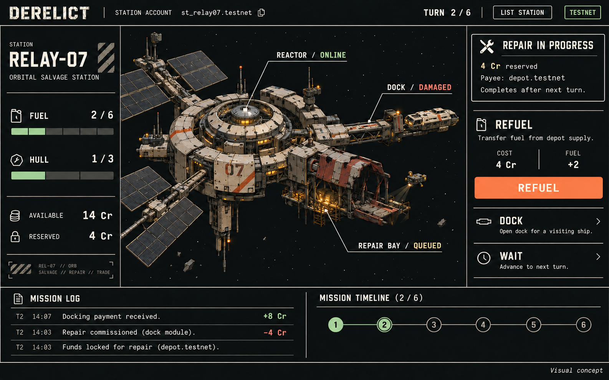

# DERELICT

**Buy the station. Inherit its condition and commitments.**

DERELICT is a six-turn orbital salvage strategy game built for the NEAR
hackathon track **NFTs That Do Something**. Every station is a real NEAR
account backed by an NEP-171 NFT that **owns its own money**: it holds
operating funds, visiting ships' escrow, and repair obligations as separate
treasury buckets. You can sell the operating station mid-contract — the new
captain inherits its fuel, damage, money, and the original repair
supplier's claim.

> *"This station owns its operating funds. I damage it earning a docking fee,
> then reserve money for repairs. Now another captain buys it while that
> repair is unfinished. My old instructions no longer work. The new captain
> inherits the station's condition, and the original repair supplier still
> gets paid."*



## 10-second start (no wallet needed)

```bash
pnpm install && pnpm --filter @derelict/game-model build
pnpm --filter derelict-web dev       # open http://localhost:5173 — practice mode
```

Practice mode runs the shared deterministic model locally: learn the whole
six-turn loop instantly. Testnet mode signs real transactions and reads real
balances — pending stays pending until the chain confirms.

## Why this is an "NFT that does something"

| Capability | Where |
| --- | --- |
| NFT as a live NEAR account | each station = a contract created by [`contracts/factory`](contracts/factory) with **zero access keys** — the contract is the sole controller |
| Asset that owns money | treasury buckets inside the station contract: operating, visitor escrow, repair reserve, seller proceeds, pending payouts (`get_buckets()` reconciles every yoctoNEAR) |
| NEP-171 compliant | `nft_token(s)`, `nft_total_supply`, `nft_supply_for_owner`, `nft_metadata`, `nft_transfer` + full receiver path (`nft_transfer_call`/`nft_resolve_transfer`) |
| Dynamic state | fuel/hull/upgrade/turn/epoch/revision live on chain; ownership epochs bump on **every** ownership change, including receiver rollbacks |
| Safe handover | exact-price purchase (`purchase(expected_revision)`) moves ownership, bumps epoch, records the seller's fixed receivable in one receipt |
| Creditor rights persist | supplier collects its repair fee by a fixed block threshold even after the captain changed; visitor rebates and seller proceeds are fixed to their accounts |

## Quick verification

```bash
cargo test -p derelict-station        # 18 contract unit tests
cd tests/integration && cargo test    # 4 sandbox tests incl. the full judging scenario
node scripts/check-parity.mjs         # published strategies: 26.000 / 27.000 credits
```

The integration test `full_judging_repair_route_with_midrepair_sale` runs the
exact demo fight on a sandbox: dock, damage, commission repair, sell
mid-repair, old captain rejected, repair effect lands under the new captain,
supplier gets paid, campaign wins at 27 credits.

## Repository layout

```text
contracts/station/        Station NFT, game, treasury, offers and sale
contracts/factory/        Station deployment and discovery index
apps/web/                 Game interface and wallet integration
packages/game-model/      Pure transition model, fixtures, previews
tests/integration/        near-workspaces sandbox scenario tests
scripts/                  Build, test, deploy, fresh-demo commands
docs/                     Architecture, frozen rules, judge's guide, threat model
design/                   Concept art and image-generation record
```

## Playing turns (rules in one look)

1 credit = 0.001 testnet NEAR. Start: 10 credits, 4 fuel, 2 hull. Win with
hull ≥ 1 and ≥ 3 ships served; **score = final operating treasury** (max 27).

| Action | Cost | Result |
| --- | --- | --- |
| Standard docking | 1 fuel | +3 Cr (+5 upgraded), serves 1 ship |
| Heavy docking | 2 fuel + 1 hull | +8 Cr, serves 1 ship |
| Refuel (1–4 units) | 2 Cr each | +fuel |
| Commission repair | reserves 4 Cr | +2 hull (cap 3) after next valid action |
| Upgrade dock | 4 Cr | standard fee becomes 5 Cr |
| Wait | — | advance the turn |

Full rules: [`docs/rules.md`](docs/rules.md). Judge walkthrough:
[`docs/judging.md`](docs/judging.md). Security posture:
[`docs/threat-model.md`](docs/threat-model.md).

## Track fit

- Primary: **NFTs That Do Something** — NFT as account, ownership with behavior.
- Secondary: **Games With Real Economies** — real native NEAR flows, real
  escrow, real receipts; the score is a live treasury, not a number.

## Status / known limitations

- [x] Shared transition model + fixtures (TS)
- [x] Station contract: ownership, buckets, offers, repair, sale, payouts
- [x] Factory + keyless station accounts
- [x] Sandbox integration tests (4/4)
- [x] Web interface
- [ ] Testnet hosting + demo video

Out of scope by design: approvals/marketplaces, custom tokens, deleting
stations. Game-over permits claims settlement forever.
