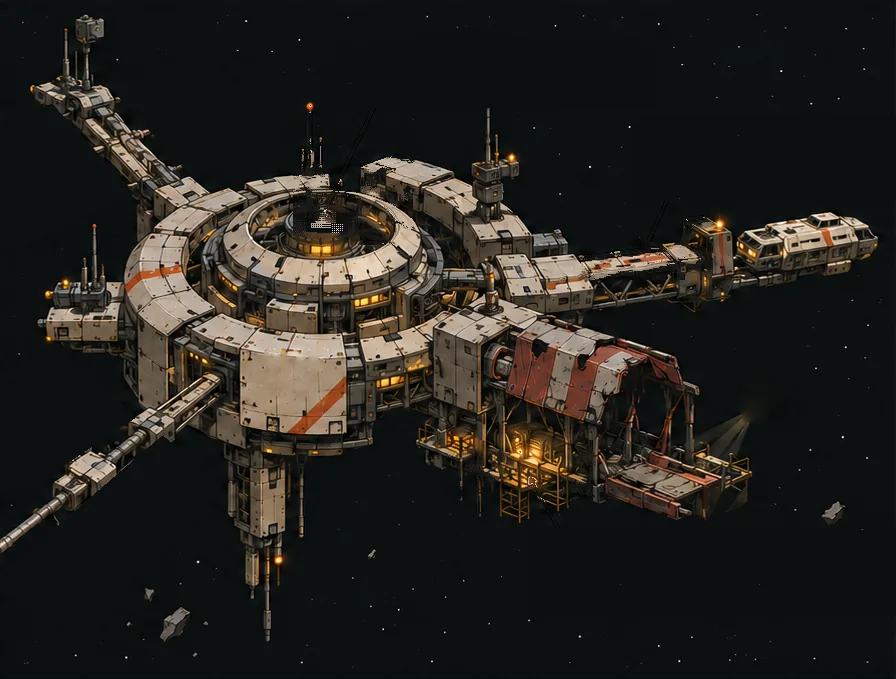

# DERELICT

**Buy the station. Inherit its condition and commitments.**

DERELICT is a six-turn strategy game about running a battered orbital salvage
station. You dock visiting ships to earn credits, manage fuel and hull damage,
and decide when a repair is worth the money. When the sixth turn ends, the
money left in the station's treasury is your score.

The station is not a picture in a database. It is an NFT on NEAR that is also
a real NEAR account, and it **owns its own money**: its operating treasury,
the fees visiting ships have prepaid, and any repair money it owes a supplier
are all held by the station itself. Sell the station mid-campaign and the
buyer inherits everything — its fuel, its damage, its treasury and its unpaid
repair bill — while the original supplier still gets paid.



## How it works

1. **Connect a wallet.** Use any NEAR testnet wallet (Meteor, Intear, …).
   Testnet NEAR is free from [near-faucet.io](https://near-faucet.io/).
2. **Launch your station.** About 6.1 testnet NEAR in two approvals: the
   station account is created with 6 NEAR held for its contract storage and
   10 credits of opening funds, then you prepay its 12 visiting ships (78
   credits of escrow, refundable if unused). Every launched station is
   owned by the wallet that launched it.
3. **Play six turns.** Each turn, pick one action, check its preview, and
   confirm it in your wallet. The screen updates only after the chain
   confirms the move.
4. **Finish with the biggest treasury.** You win if the hull survives and you
   served at least three ships. The best possible score is 27 credits.
5. **Sell or buy at any point.** List your station for a price, or buy one
   that is listed. Ownership moves with everything the station carries.

The app opens on a connect screen and then shows the stations your wallet
owns; **How it works** in the app walks through all of this. Any station can
also be viewed read-only with `?station=<account>`.

## Rules at a glance

1 credit = 0.001 testnet NEAR. Every station starts with 10 credits, 4 fuel
and 2 hull (fuel holds 6, hull holds 3).

| Action | Cost | Result |
| --- | --- | --- |
| Standard docking | 1 fuel | +3 credits (+5 with an upgraded dock), one ship served |
| Heavy docking | 2 fuel and 1 hull | +8 credits, one ship served |
| Refuel | 2 credits per unit (1–4) | more fuel |
| Commission repair | 4 credits set aside | +2 hull after your next action |
| Upgrade dock | 4 credits, once | standard docking pays 5 credits |
| Wait | — | the turn passes |

- Each action uses one of your six turns; a rejected action uses none.
- Docking needs a visiting ship that has prepaid, and a hull above zero.
- **Score** = the station's operating treasury after turn 6.
- **Win** = hull of at least 1 and at least 3 ships served.
- Selling, buying, funding visitors and claiming payments do not use turns.

Full rules: [`docs/rules.md`](docs/rules.md).

## What is real

Everything on screen is read back from the station contract; nothing is
simulated, and a pending transaction stays pending until the chain confirms
it.

| What | How |
| --- | --- |
| The station is an account | Each station is created by [`contracts/factory`](contracts/factory) with **no access keys** — its contract is the only thing that can move its money |
| It owns its money | Separate treasury buckets for operating funds, visitor escrow, the repair reserve, seller proceeds and pending payouts; `get_buckets()` accounts for every yoctoNEAR |
| It is a standard NFT | NEP-171: `nft_token(s)`, `nft_total_supply`, `nft_supply_for_owner`, `nft_metadata`, `nft_transfer`, and the full `nft_transfer_call` receiver path |
| Its state lives on chain | Fuel, hull, upgrade, turn, owner epoch and revision; the epoch increases on every change of owner |
| Sales are safe | `purchase(expected_revision)` pays exactly the listed price to the seller and moves ownership in one step |
| Debts survive a sale | The repair supplier, visitor refunds and seller proceeds stay owed to the same accounts whoever owns the station |

## Run it locally

```bash
pnpm install
pnpm --filter @derelict/game-model build
pnpm --filter derelict-web dev       # open http://localhost:5173
```

Tests:

```bash
cargo test -p derelict-station            # contract unit tests
cd tests/integration && cargo test        # sandbox scenario tests, incl. a mid-repair sale
pnpm --filter @derelict/game-model test   # rules model and the 26 / 27 credit strategies
```

## Project layout

```text
contracts/station/        Station NFT: game rules, treasury, offers, sale
contracts/factory/        Creates stations and keeps the station index
apps/web/                 The game interface and wallet integration
packages/game-model/      Rules model used for action previews
tests/integration/        Sandbox scenario tests
docs/                     Rules, architecture, threat model, on-chain verification
```

## Documentation

- [`docs/rules.md`](docs/rules.md) — complete rules
- [`docs/architecture.md`](docs/architecture.md) — how the station, factory and app fit together
- [`docs/verify.md`](docs/verify.md) — checking a station's state and money on chain
- [`docs/threat-model.md`](docs/threat-model.md) — security assumptions
